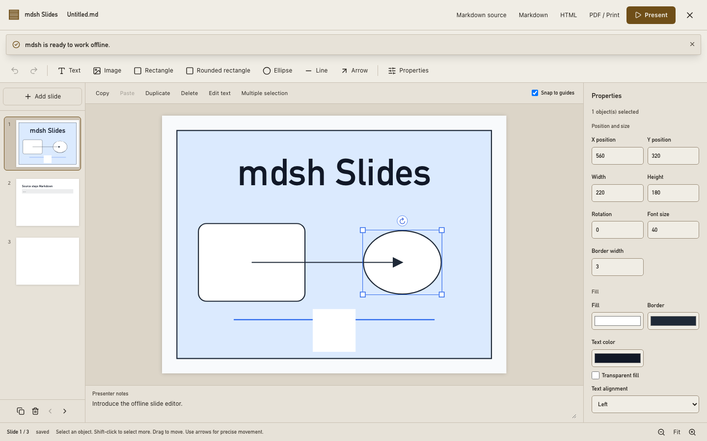
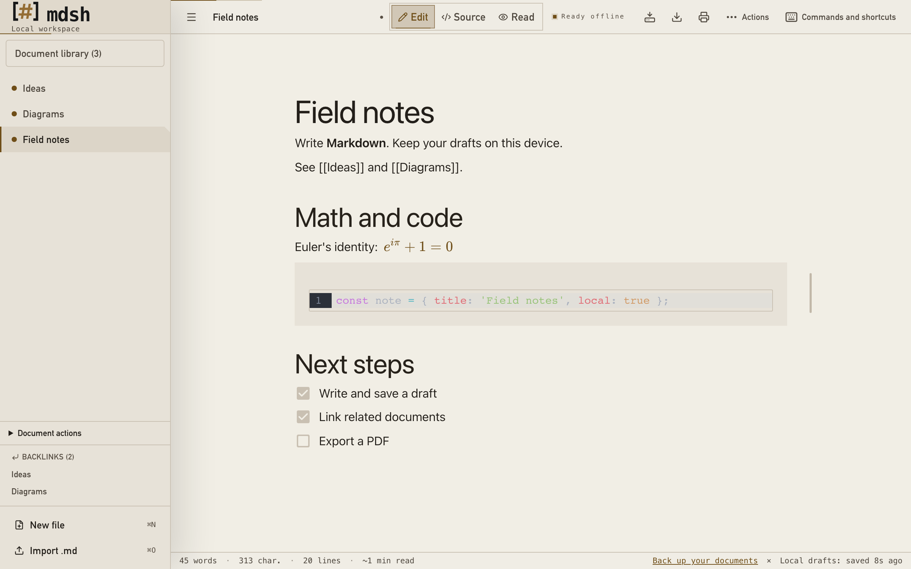

# mdsh

A local Markdown workspace with visual editing, source editing, reading, and a slide editor.
Documents stay on your device. The app needs no account, backend, or telemetry.

[Web app](https://thomascrouzet.github.io/mdsh/) ·
[Releases](https://github.com/ThomasCrouzet/mdsh/releases) ·
[User guide](docs/USER_GUIDE.md)



The screenshot and features below describe this source tree. Published builds can differ.

## Write, organize, and export

| Area     | Features                                                                             |
| -------- | ------------------------------------------------------------------------------------ |
| Editing  | Visual Markdown, CodeMirror source, rendered reading, and resizable source preview   |
| Content  | Tables, task lists, code, KaTeX formulas, Mermaid diagrams, front matter, and images |
| Library  | Search, tags, wiki links, backlinks, workspaces, templates, history, and trash       |
| Projects | Folder and ZIP import, local assets, relative links, and project ZIP export          |
| Export   | Markdown, PDF, self-contained HTML, and JSON backups with optional encryption        |
| Slides   | Text, images, shapes, connectors, presenter notes, and Markdown-backed layouts       |

Select **Slides** to arrange objects, reorder slides, or start a presentation.
The [presentation guide](docs/presentation-editor.md) explains controls, exports, and the [file format](docs/presentation-format.md).



## Use the app

Open the web app, then create a document, import Markdown, or open the built-in demo.
Use **Edit**, **Source**, and **Read** to change views. Settings provides English and French interfaces and light or dark themes.

Install the PWA through your browser and wait for offline preparation before disconnecting.
Remote images remain blocked until you allow them for a document. Loading them contacts their host.

Chromium can save back to disk through the File System Access API where available.
Firefox and Safari use download fallbacks. Tauri Desktop uses native file access.
See the [Desktop guide](docs/USER_GUIDE.md#desktop-beta-app) for platform requirements and unsigned installer details.

## Data and limits

- Drafts use IndexedDB with a 400 ms save delay. The interface reports write failures.
- Closing a document keeps it in the library. Deleting it moves it to trash for 30 days.
- Backups include documents, projects, assets, workspaces, and templates. They exclude trash, version history, and disk permissions.
- Browser storage is not a backup. Export a backup before clearing site data or changing browser profiles.
- Visual editing can normalize Markdown. Use Source when exact formatting matters.
- Cloud synchronization, collaboration, and plugins are outside the project scope.

See [backups and storage](docs/USER_GUIDE.md#backups-and-storage-health) and [security](SECURITY.md) for details.

## Local development

Use Node.js 22 or later and npm. Keep the committed lockfile.

```sh
npm ci --legacy-peer-deps
npm run dev
```

The stack uses Svelte, SvelteKit, TypeScript, Milkdown, CodeMirror, Dexie, and Tauri.
[CONTRIBUTING.md](CONTRIBUTING.md) lists the Rust toolchain and native libraries for Desktop builds.

Before a pull request:

```sh
npm run check
npm run lint
npm test
npm run build
npm run size
npx playwright install --with-deps chromium firefox webkit
npx playwright test --ignore-snapshots --grep-invert "Snapshots visuels"
```

On Linux without a display, prefix the browser command with `xvfb-run -a`.
Browser checks retain reports and repeatable evidence. See [testing](docs/TESTING.md) for commands, artifacts, and coverage limits.
CI publishes GitHub Pages after checks pass on a push to `main`.

## Documentation

[Documentation index](docs/README.md) · [Architecture](ARCHITECTURE.md) ·
[Development](docs/DEVELOPMENT.md) · [Shortcuts](docs/USER_GUIDE.md) ·
[Brand assets and capture](docs/BRANDING.md) · [Support](SUPPORT.md)

## License

[MIT](LICENSE). See [third-party notices](THIRD_PARTY_NOTICES.md) for redistributed assets.
