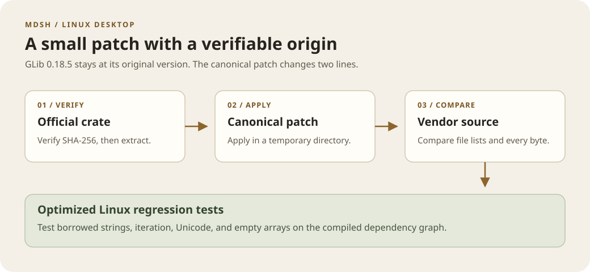

# GLib 0.18.5 security backport

The Linux Tauri toolchain still requires GLib 0.18 through GTK3.
This patch applies the upstream fix for GHSA-wrw7-89jp-8q8g and RUSTSEC-2024-0429 without changing the API, package version, or licenses.



## Source and patch

- [Published crate](https://static.crates.io/crates/glib/glib-0.18.5.crate), SHA-256: `233daaf6e83ae6a12a52055f568f9d7cf4671dabb78ff9560ab6da230ce00ee5`
- [Package source](https://github.com/gtk-rs/gtk-rs-core/tree/42b9caf98e03ded086362d9653ca58fe94dc8658/glib)
- [Upstream fix](https://github.com/gtk-rs/gtk-rs-core/commit/b5a4071e439bef2b5eea76c3aa25e5ae84839e34) and [review](https://github.com/gtk-rs/gtk-rs-core/pull/1343)
- [Official 0.19 backport](https://github.com/gtk-rs/gtk-rs-core/commit/44ff04449535135aa82507ff492883bba77a9b75) and [RustSec advisory](https://rustsec.org/advisories/RUSTSEC-2024-0429.html)
- Original [MIT license](../../src-tauri/vendor/glib/LICENSE) and [copyright notices](../../src-tauri/vendor/glib/COPYRIGHT)

[variant-str-iter.patch](variant-str-iter.patch) changes two lines in `src/variant_iter.rs`.
It makes the output pointer mutable and passes a mutable reference to GLib.
The former immutable reference caused undefined behavior.

## Regenerate or verify

From the repository root, use Node.js 22 or later, Git, and tar:

```sh
node scripts/vendor-glib.mjs --write
node scripts/vendor-glib.mjs --check
```

Both commands verify the archive checksum before extraction.
`--check` applies the patch in a temporary directory and compares every vendor file byte for byte.
Add `--archive /path/to/glib-0.18.5.crate` to use a local archive.
Edit the canonical patch, then regenerate. Do not edit `src-tauri/vendor/glib/` directly.

## Regression evidence

Linux CI installs the Tauri system libraries and runs the [optimized regression tests](../../src-tauri/tests/glib_variant_regression.rs):

```sh
cargo test --manifest-path src-tauri/Cargo.toml --release --locked --test glib_variant_regression
cargo audit --file src-tauri/Cargo.lock --deny unsound
```

For upstream tests, use a temporary copy:

```sh
cargo test --release --manifest-path /path/to/temporary-copy/Cargo.toml variant_iter::tests::
```

Relevant upstream tests include `test_variant_iter_array`, `test_variant_str_iter_nth`, and `test_variant_str_iter_last`.
Use optimized builds to reproduce the defect. Isolate unpatched execution because it can terminate with `SIGSEGV`.

The Desktop workflow checks the vendor inventory on each platform. Git attributes preserve upstream bytes on Windows.
The Cargo SBOM records the backport, patch checksum, and upstream references while retaining version 0.18.5.
Cargo-audit can exclude local dependencies without a registry source. An absent alert does not prove the fix.
Use verified provenance, the patch comparison, and optimized tests as evidence.
Remove the backport when the GTK toolchain permits an officially fixed version.
